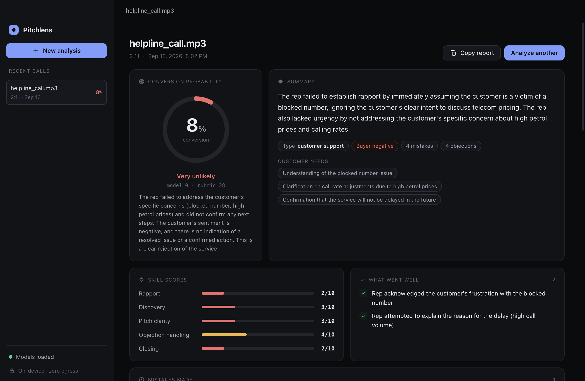
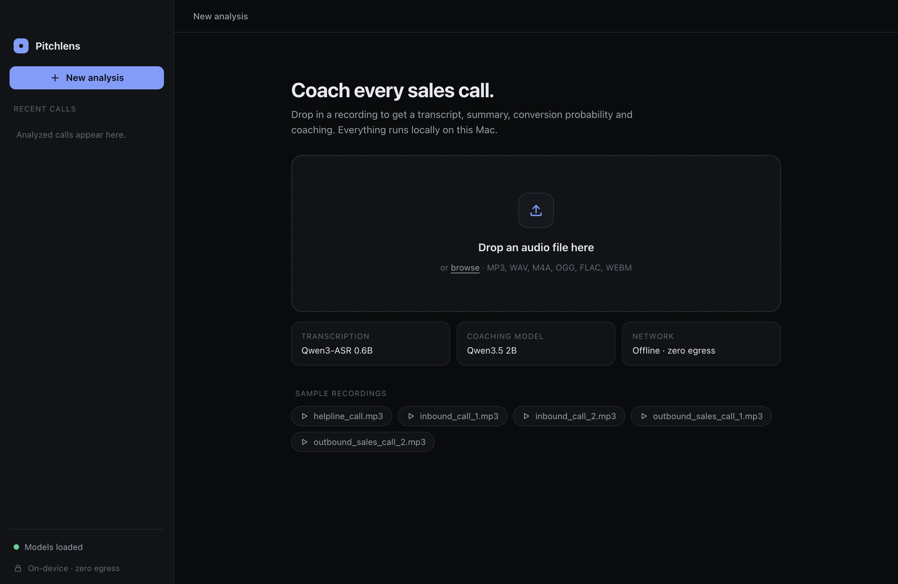
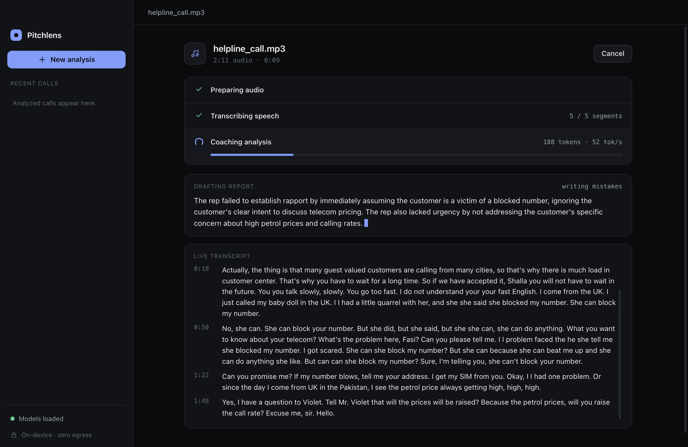
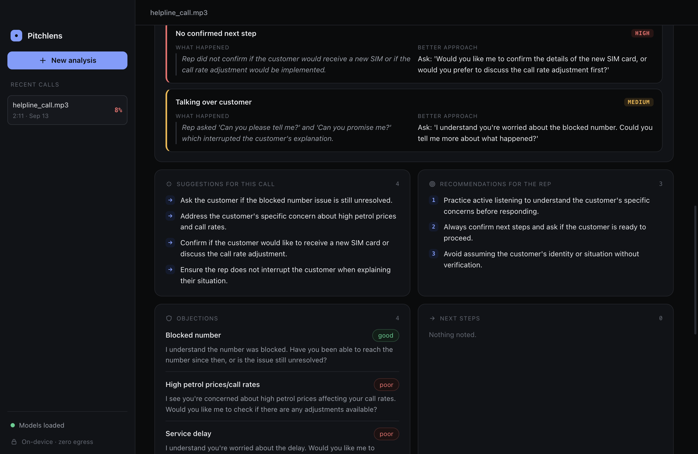

# Pitchlens

**On-device sales call coaching for macOS and Windows.** Drop in a call recording and get a transcript, summary,
conversion probability, skill scores, mistakes, objections, suggestions and recommendations for the sales rep —
all generated by two small quantized models running locally. **Zero egress:** no audio, text or telemetry leaves the computer.



📄 **One-page overview of the pipeline and components:** [docs/Pitchlens-How-It-Works.pdf](docs/Pitchlens-How-It-Works.pdf)

## Features

- Drag & drop any audio file (MP3, WAV, M4A, OGG, FLAC, WEBM…)
- Live progress with a streaming transcript and a report that drafts itself as the model writes
- Conversion probability, 5 skill scores, strengths, mistakes (with evidence and better wording),
  objections, suggestions, rep recommendations and next steps
- Timestamped transcript with click-to-play audio
- History of analyzed calls, copy as Markdown, **export as PDF**
- Dark, lightweight UI — vanilla HTML/CSS/JS, no framework, no gradients

| Upload | Live progress | Coaching |
| --- | --- | --- |
|  |  |  |

## Models (GGUF, 2026)

| Role | Model | Quant | Size | Source |
| --- | --- | --- | --- | --- |
| Speech-to-text | Qwen3-ASR 0.6B (Jan 2026) | Q8_0 + audio projector | 1.0 GB | [ggml-org/Qwen3-ASR-0.6B-GGUF](https://huggingface.co/ggml-org/Qwen3-ASR-0.6B-GGUF) |
| Coaching analysis | Qwen3.5 2B (Feb 2026) | Q4_K_M | 1.3 GB | [unsloth/Qwen3.5-2B-GGUF](https://huggingface.co/unsloth/Qwen3.5-2B-GGUF) |

Both run through [llama.cpp](https://github.com/ggml-org/llama.cpp)'s `llama-server` — on the Metal GPU on
Apple Silicon, and on CUDA, Vulkan or CPU on Windows depending on the llama.cpp build you install.

## Platform support

| Platform | Status | GPU backend |
| --- | --- | --- |
| macOS (Apple Silicon) | Tested on MacBook Air M5 | Metal |
| Windows 10/11 (x64) | Supported, not yet benchmarked | CUDA (NVIDIA), Vulkan (AMD/Intel/NVIDIA) or CPU |

The app itself is plain Electron + Node, so it runs anywhere Electron does; the only native pieces are
`llama-server` and `ffmpeg`, which you install per platform.

## Setup

You need **Node.js 20+**, **Git with Git LFS**, **llama.cpp** (`llama-server`) and **ffmpeg**.

### macOS

```bash
brew install node llama.cpp ffmpeg git-lfs
git lfs install
git clone https://github.com/NandhaKishorM/pitchlens.git
cd pitchlens
npm install
npm start
```

### Windows (PowerShell)

```powershell
winget install OpenJS.NodeJS.LTS Git.Git
winget install llama.cpp
winget install ffmpeg
# open a new terminal so PATH picks up the new tools
git lfs install
git clone https://github.com/NandhaKishorM/pitchlens.git
cd pitchlens
npm install
npm start
```

**GPU on Windows:** for the best speed, use a GPU build of llama.cpp from the
[llama.cpp releases](https://github.com/ggml-org/llama.cpp/releases) — `win-cuda` for NVIDIA or `win-vulkan`
for AMD/Intel/NVIDIA. Unzip it and either put the folder on your `PATH`, copy the files into a `bin\`
folder inside this repo, or point the app at it:

```powershell
$env:PITCHLENS_LLAMA_SERVER = "C:\llama.cpp\llama-server.exe"
npm start
```

### Where the app looks for tools

In order: the `PITCHLENS_LLAMA_SERVER` / `PITCHLENS_FFMPEG` / `PITCHLENS_FFPROBE` environment variables,
a `bin/` folder in the repo, your `PATH`, then common install locations
(Homebrew on macOS; WinGet links, Scoop shims, Chocolatey and Program Files on Windows).
If something is missing, the app shows what to install on the start screen.

### Models and Git LFS

The GGUF models are stored with **Git LFS** in `models/`, so a normal clone downloads them (~2.3 GB).
To skip the large files and fetch them straight from Hugging Face instead:

```bash
GIT_LFS_SKIP_SMUDGE=1 git clone https://github.com/NandhaKishorM/pitchlens.git   # macOS
cd pitchlens && npm install
npm run models
```

```powershell
$env:GIT_LFS_SKIP_SMUDGE = "1"; git clone https://github.com/NandhaKishorM/pitchlens.git   # Windows
cd pitchlens; npm install
npm run models
```

## How it works

```
audio file ─▶ ffmpeg ─▶ Qwen3-ASR 0.6B ─▶ Qwen3.5 2B ─▶ report (UI · history · PDF)
             16 kHz mono,   transcript per     JSON report constrained
             split at pauses   ~25 s chunk      by a JSON schema
```

1. **Prepare** — `ffmpeg` decodes to 16 kHz mono and detects pauses in one pass, then splits into ~25 s chunks
   at silences so words aren't cut.
2. **Transcribe** — each chunk goes to the speech engine; lines stream into the UI as they finish.
3. **Analyze** — the 2B model reads the transcript as a sales coach and fills a fixed JSON schema (enforced by
   llama.cpp's grammar). The conversion probability blends the model's estimate (70%) with its skill rubric (30%).
   Broken output fragments are filtered, and very long calls are condensed into notes first.
4. **Report** — rendered as cards, saved to history, exportable as PDF.

### Architecture

| Layer | File | Job |
| --- | --- | --- |
| UI | `src/renderer/app.js` | Upload, progress, report, history |
| Bridge | `src/main/preload.js` | Small fixed API between the sandboxed UI and the system |
| Main process | `src/main/main.js` | Window, network lock-down, file dialogs, IPC, PDF export |
| Pipeline | `src/core/pipeline.js` | Orchestrates prepare → transcribe → analyze |
| Audio | `src/core/audio.js` | ffmpeg conversion, silence detection, chunking |
| Speech | `src/core/transcribe.js` | Chunk requests to Qwen3-ASR, text cleanup |
| Analysis | `src/core/analyze.js` | Coaching prompt, JSON schema, streaming, output validation |
| Engines | `src/core/llamaServer.js`, `engines.js` | Start, health-check and stop the two `llama-server` processes |
| Tools | `src/core/proc.js` | Cross-platform lookup of `llama-server` / `ffmpeg` binaries |
| PDF | `src/main/reportPdf.js` | Print-friendly report layout → PDF |
| Client | `src/core/remoteClient.js` | Uploads to the orchestrator and follows its progress stream |
| Orchestrator | `server/src/orchestrator.js` | Engine pool, job queue, cancellation, idle unload |
| Graph | `server/src/graph.js` | The pipeline as a LangGraph state graph |

### Privacy (zero egress)

- Model servers are spawned on `127.0.0.1` only, with `--offline`, loading models from local paths.
- The Electron session cancels every request that isn't `file:`/`data:`/`blob:`; the page CSP sets `connect-src 'none'`.
- The renderer is sandboxed with context isolation; permission requests are denied.
- Analyses are saved locally: `~/Library/Application Support/pitchlens/history` on macOS,
  `%APPDATA%\pitchlens\history` on Windows.

## Run the models on a server (optional)

By default the app loads the models itself. It can instead talk to the **LangGraph orchestrator** in
[`server/`](server/README.md), so one machine with a GPU serves several people:

```bash
cd server && npm install && npm start      # hosts the GGUF models on :8787
cd .. && PITCHLENS_SERVER_URL=http://your-server:8787 npm start
```


The orchestrator keeps an engine pool (starting, health-checking and unloading `llama-server` per model),
queues jobs so one GPU is not oversubscribed, runs the pipeline as a LangGraph graph
(`prepare → transcribe → condense? → analyze → finalize`), and streams progress to clients. The models can
also live on yet another machine via `PITCHLENS_ASR_URL` / `PITCHLENS_LLM_URL`. Full API and settings:
[`server/README.md`](server/README.md).

**Note:** zero egress applies to the default local mode. In server mode your audio and transcripts go to
that server, so put it behind an API key and TLS if it is not on your own machine.

## Performance

Measured on a MacBook Air M5 (16 GB) **while OBS and Google Meet were also using the GPU**:

| Call | Audio | Transcription | Analysis | Total |
| --- | --- | --- | --- | --- |
| helpline_call.mp3 | 2:11 | 4.6 s (28× realtime) | 18.9 s @ 51 tok/s | 23.7 s |
| outbound_sales_call_1.mp3 | 5:21 | 12.0 s (27× realtime) | 11.7 s @ 49 tok/s | 23.9 s |

Model load ≈ 1 s each · ≈ 1.5 GB memory per engine. On Windows, speed depends mostly on the llama.cpp
backend: a CUDA or Vulkan build on a discrete GPU is comparable or faster; CPU-only builds are several times slower.

### Benchmark it yourself

```bash
npm run samples                        # download public sample calls into samples/
npm run bench                          # run the full pipeline on every sample
npm run bench -- path/to/call.mp3      # or on specific files
```

Prints per-stage timings, tokens/s and engine memory (memory is macOS only), and writes JSON + transcripts to
`samples/results/`. Sample recordings come from
[Magellan Solutions](https://www.magellan-solutions.com/resources/sample-recordings/) and the Internet Archive
([CallCenterAudio](https://archive.org/details/CallCenterAudio)); they are not included in the repo.

## Scripts

| Command | What it does |
| --- | --- |
| `npm start` | Launch the app |
| `npm run models` | Download the GGUF models from Hugging Face |
| `npm run samples` | Download sample call recordings |
| `npm run bench` | Headless pipeline benchmark |

## Limitations

- Transcripts have no speaker labels; the model infers who the rep is from context.
- A 2B model's probability is a coaching signal, not a forecast.
- Speed depends on the GPU backend and on what else is using the GPU.
- Windows support has not been benchmarked on real hardware yet — issues and timings are welcome.
