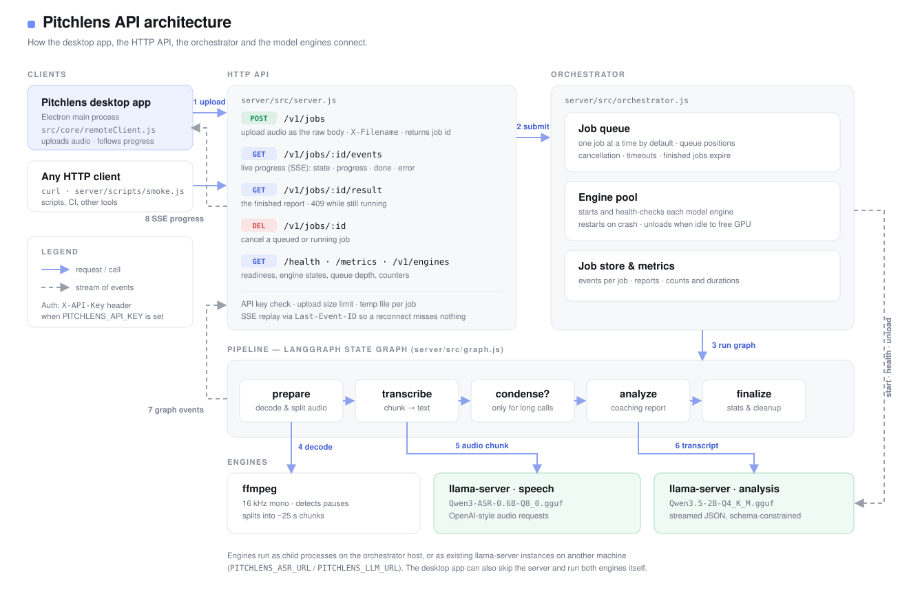

# Pitchlens orchestrator

A small service that **hosts the GGUF models** and runs the Pitchlens pipeline as a
[LangGraph](https://docs.langchain.com/oss/javascript/langgraph/overview) graph, so several people (or
several machines) can share one GPU instead of each laptop loading its own copy of the models.



## What the orchestrator does

- **Engine pool** — starts `llama-server` for each model, health-checks it, restarts it if it dies, and
  **unloads both after an idle period** to release GPU memory. They reload automatically on the next job.
- **Queue** — runs one job at a time by default (a single GPU), reports queue position, and supports
  cancellation and per-job timeouts.
- **Pipeline graph** — `prepare → transcribe → prosody → (condense if the call is long) → analyze → finalize`.
- **Live progress** — every step is streamed to clients over Server-Sent Events.
- **Split deployment** — the models can run on other machines entirely (see `PITCHLENS_ASR_URL` below).

## Run it

```bash
brew install llama.cpp ffmpeg          # Windows: winget install llama.cpp ffmpeg
cd server
npm install
npm start                              # http://127.0.0.1:8787
```

The models are read from `../models`, the same folder the desktop app uses.

Check it and run a call through it:

```bash
curl -s http://127.0.0.1:8787/health | jq
node scripts/smoke.js ../samples/helpline_call.mp3
```

## Point the app at it

```bash
cd ..
PITCHLENS_SERVER_URL=http://your-server:8787 npm start
```

The app then uploads audio instead of loading models, and shows **Server · host** on the start screen.
Without that variable it keeps running everything locally.

## API

| Method | Path | What it does |
| --- | --- | --- |
| `GET` | `/health` | Readiness only: `{ ok, problems }`. Deliberately minimal and unauthenticated — see [Security](#security). |
| `GET` | `/v1/status` | Full status: engines, queue, metrics. Authenticated. |
| `POST` | `/v1/jobs` | Upload audio as the raw request body; `X-Filename` names it. Requires `Content-Length`. Returns the job. |
| `GET` | `/v1/jobs` | Your client's jobs. Authenticated. |
| `GET` | `/v1/jobs/:id` | One job, with the report once it is done. |
| `GET` | `/v1/jobs/:id/events` | Live progress (SSE): `state`, `progress`, `done`, `error`, `close`. |
| `GET` | `/v1/jobs/:id/result` | The report (409 while it is still running). |
| `DELETE` | `/v1/jobs/:id` | Cancel a queued or running job. |
| `GET` | `/v1/engines`, `/metrics` | Engine detail and counters. Authenticated. |

Every route except `/health` requires the API key, and a job is only visible to the
client that created it — see [Security](#security).

```bash
# submit and follow
curl -s -X POST http://127.0.0.1:8787/v1/jobs \
  -H 'x-filename: call.mp3' --data-binary @call.mp3
curl -N http://127.0.0.1:8787/v1/jobs/<id>/events
```

Reconnecting to `/events` replays what you missed — pass `Last-Event-ID` or `?since=<seq>`.

## Settings

| Variable | Default | Meaning |
| --- | --- | --- |
| `PITCHLENS_HOST` / `PITCHLENS_PORT` | `127.0.0.1` / `8787` | Where to listen. |
| `PITCHLENS_API_KEY` | _(none)_ | Required in `X-API-Key` (or `Authorization: Bearer`) when set. |
| `PITCHLENS_API_KEYS` | _(none)_ | `name:secret,name2:secret2` — gives each client its own namespace (see below). |
| `PITCHLENS_CONCURRENCY` | `1` | Jobs running at once. Raise only with GPU memory to spare. |
| `PITCHLENS_MAX_QUEUE` | `20` | Waiting jobs before new uploads get HTTP 429. |
| `PITCHLENS_JOB_TIMEOUT_S` | `1800` | Give up on a job after this long. |
| `PITCHLENS_JOB_TTL_S` | `3600` | How long finished jobs stay readable. |
| `PITCHLENS_MAX_JOBS` | `200` | Hard cap on jobs held in memory; oldest finished ones are evicted. |
| `PITCHLENS_MAX_JOB_EVENTS` | `2000` | Cap on replayable events kept per job. |
| `PITCHLENS_IDLE_UNLOAD_S` | `900` | Unload the models after this idle time (`0` keeps them loaded). |
| `PITCHLENS_MAX_UPLOAD_MB` | `300` | Upload size limit. |
| `PITCHLENS_MAX_INFLIGHT_MB` | `1200` | Total upload bytes allowed on disk at once. |
| `PITCHLENS_MAX_CONNECTIONS` | `256` | Maximum concurrent HTTP connections. |
| `PITCHLENS_HEADERS_TIMEOUT_S` | `30` | Time allowed to finish sending request headers. |
| `PITCHLENS_REQUEST_TIMEOUT_S` | `900` | Time allowed to send the whole request body (uploads). |
| `PITCHLENS_RESULTS_DIR` | _(none)_ | Also write each report to this folder as JSON. |
| `PITCHLENS_WARM` | `1` | Load the models at startup (`0` waits for the first job). |
| `PITCHLENS_ASR_URL`, `PITCHLENS_LLM_URL` | _(none)_ | Use `llama-server` instances already running elsewhere instead of spawning them. |

### Models on separate machines

Run the GGUF models wherever the GPU is, then let the orchestrator use them:

```bash
# on the GPU box
llama-server -m Qwen3-ASR-0.6B-Q8_0.gguf --mmproj mmproj-Qwen3-ASR-0.6B-Q8_0.gguf -c 4096 --host 0.0.0.0 --port 8081
llama-server -m Qwen3.5-2B-Q4_K_M.gguf -c 16384 -fa on --jinja --host 0.0.0.0 --port 8082

# on the orchestrator
PITCHLENS_ASR_URL=http://gpu-box:8081 PITCHLENS_LLM_URL=http://gpu-box:8082 npm start
```

The orchestrator still needs `ffmpeg` locally, because it prepares the audio before sending it on.

## Security

The service binds to loopback and has no API key by default. Before exposing it to a network:

1. Set `PITCHLENS_API_KEY` (it warns at startup if you listen beyond loopback without one).
2. Put it behind TLS — uploads and transcripts are plain HTTP otherwise.
3. Remember call recordings and transcripts now leave the laptop. The desktop app's zero-egress promise
   applies to local mode; in server mode your audio goes to this server.

**What is and isn't public.** `GET /health` is the only unauthenticated route, and it
returns nothing but `{ ok, problems }` — no engine URLs, model names, queue depth or
metrics. That matters because the orchestrator is often deployed with the models on
another machine, and those `llama-server` processes have no authentication of their own;
publishing their hostnames and ports to anonymous callers would hand out the addresses of
exactly the things worth not reaching. Everything else is authenticated.

**Per-client keys.** With a single shared key every client is the same principal, so they
can read and cancel each other's jobs. Give each person their own:

```bash
PITCHLENS_API_KEYS='alice:...bob:...' npm start
```

Each job is then scoped to the name in front of its key: `GET /v1/jobs` lists only your
own calls, and another client's job ids return 404. The desktop app just needs
`PITCHLENS_API_KEY` set to whichever secret it was given — it picks the name up for you.

**Resource limits.** Connections, header time, request body time, upload size, total
in-flight upload bytes, queue depth, retained jobs and retained events per job are all
bounded and all configurable — see [Settings](#settings). Uploads are refused on their
`Content-Length` before any bytes are written.

**Still your responsibility.** `ffmpeg` parses every uploaded file, unsandboxed, as the
service user. Keep it patched, and put the whole thing behind TLS and a firewall rather
than relying on the application alone.

## Layout

| File | Job |
| --- | --- |
| `src/server.js` | HTTP API, uploads, SSE streaming, auth |
| `src/orchestrator.js` | Queue, scheduling, cancellation, timeouts, idle unload, metrics |
| `src/graph.js` | The LangGraph pipeline and its nodes |
| `src/engines.js` | Engine pool: local `llama-server` processes or remote ones |
| `src/config.js` | Environment settings |
| `scripts/smoke.js` | End-to-end check against a running server |

The audio, speech, voice and analysis code is shared with the desktop app (`../src/core`), so both paths
behave identically.
